
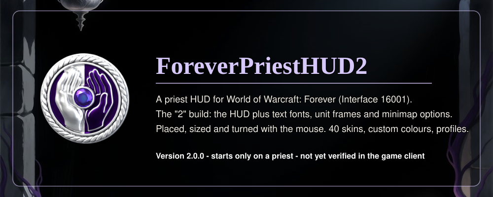

**ForeverPriestHUD2** is a priest HUD for World of Warcraft: Forever (Interface 16001). Open its menu with `/fpr2`.
Version 2.0.0. **Not yet verified in the game client.** It starts only on a priest.

Every panel below is drawn on this class's menu backdrop. Under each one, "Text version" holds the
same words as plain text.

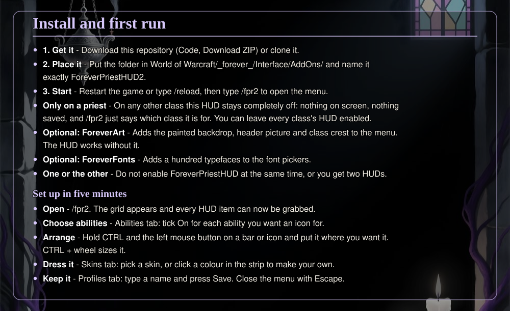

Text version: Install and first run

- **1. Get it** - Download this repository (Code, Download ZIP) or clone it.
- **2. Place it** - Put the folder in World of Warcraft/_forever_/Interface/AddOns/ and name it exactly ForeverPriestHUD2.
- **3. Start** - Restart the game or type /reload, then type /fpr2 to open the menu.
- **Only on a priest** - On any other class this HUD stays completely off: nothing on screen, nothing saved, and /fpr2 just says which class it is for. You can leave every class's HUD enabled.
- **Optional: ForeverArt** - Adds the painted backdrop, header picture and class crest to the menu. The HUD works without it.
- **Optional: ForeverFonts** - Adds a hundred typefaces to the font pickers.
- **One or the other** - Do not enable ForeverPriestHUD at the same time, or you get two HUDs.

**Set up in five minutes**

- **Open** - /fpr2. The grid appears and every HUD item can now be grabbed.
- **Choose abilities** - Abilities tab: tick On for each ability you want an icon for.
- **Arrange** - Hold CTRL and the left mouse button on a bar or icon and put it where you want it. CTRL + wheel sizes it.
- **Dress it** - Skins tab: pick a skin, or click a colour in the strip to make your own.
- **Keep it** - Profiles tab: type a name and press Save. Close the menu with Escape.

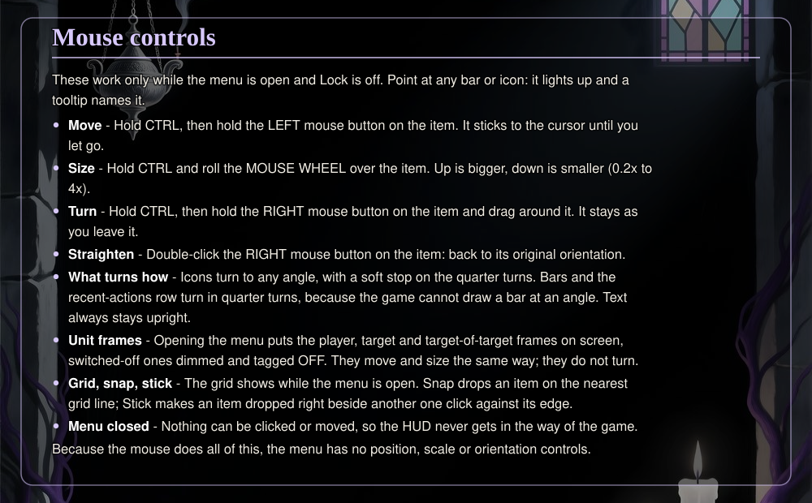

Text version: Mouse controls

These work only while the menu is open and Lock is off. Point at any bar or icon: it lights up and a tooltip names it.

- **Move** - Hold CTRL, then hold the LEFT mouse button on the item. It sticks to the cursor until you let go.
- **Size** - Hold CTRL and roll the MOUSE WHEEL over the item. Up is bigger, down is smaller (0.2x to 4x).
- **Turn** - Hold CTRL, then hold the RIGHT mouse button on the item and drag around it. It stays as you leave it.
- **Straighten** - Double-click the RIGHT mouse button on the item: back to its original orientation.
- **What turns how** - Icons turn to any angle, with a soft stop on the quarter turns. Bars and the recent-actions row turn in quarter turns, because the game cannot draw a bar at an angle. Text always stays upright.
- **Unit frames** - Opening the menu puts the player, target and target-of-target frames on screen, switched-off ones dimmed and tagged OFF. They move and size the same way; they do not turn.
- **Grid, snap, stick** - The grid shows while the menu is open. Snap drops an item on the nearest grid line; Stick makes an item dropped right beside another one click against its edge.
- **Menu closed** - Nothing can be clicked or moved, so the HUD never gets in the way of the game.

Position and turning are done with the mouse; size is done both ways: CTRL + wheel on the item, or the Scale slider in the menu (one for each bar and each icon). The menu has no X / Y or orientation controls.

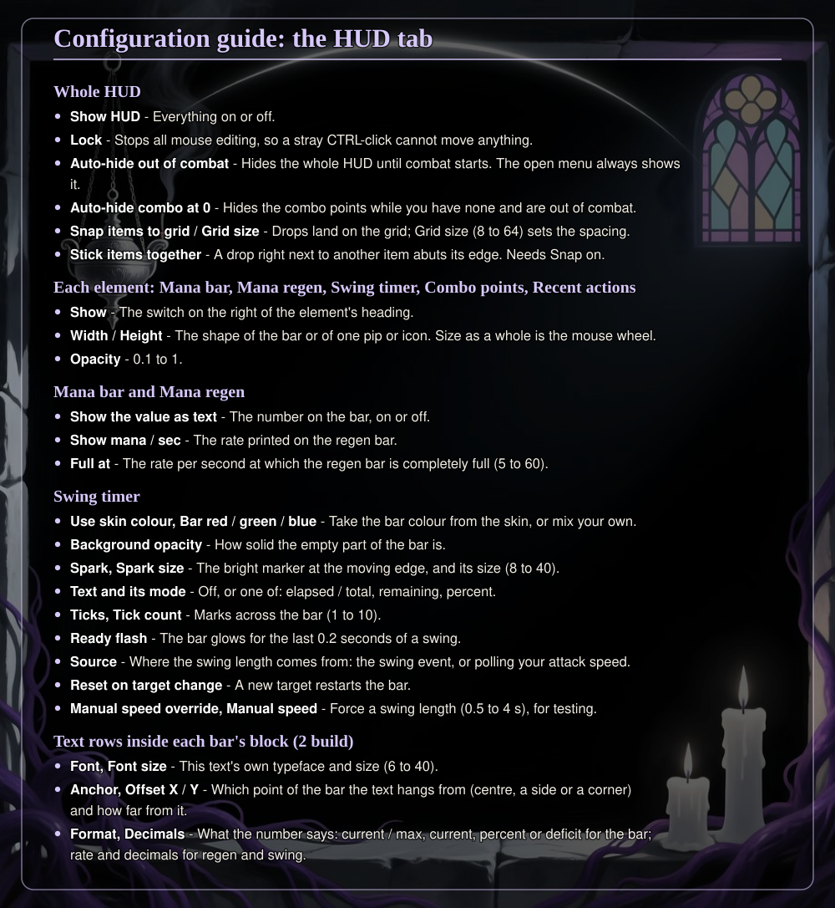

Text version: Configuration guide: the HUD tab

**Whole HUD**

- **Show HUD** - Everything on or off.
- **Lock** - Stops all mouse editing, so a stray CTRL-click cannot move anything.
- **Auto-hide out of combat** - Hides the whole HUD until combat starts. The open menu always shows it.
- **Auto-hide combo at 0** - Hides the combo points while you have none and are out of combat.
- **Snap items to grid / Grid size** - Drops land on the grid; Grid size (8 to 64) sets the spacing.
- **Join energy, regen and swing into one bar** - Switch on from the HUD tab. The regen overlay sits on the energy bar and the swing strip runs under it; the three move and scale together. Each keeps its own colours and options.
- **Stick items together** - A drop right next to another item abuts its edge. Needs Snap on.

**Each element: Mana bar, Mana regen, Swing timer, Combo points, Recent actions**

- **Show** - The switch on the right of the element's heading.
- **Width / Height** - The shape of the bar or of one pip or icon.
- **Opacity** - 0.1 to 1.
- **Scale** - Size of the whole item, 0.5 to 3. The same value as CTRL + wheel on the item. Hold CTRL and roll the wheel over this slider to step it by 0.05.

**Mana bar and Mana regen**

- **Show the value as text** - The number on the bar, on or off.
- **Show mana / sec** - The rate printed on the regen bar.
- **Full at** - The rate per second at which the regen bar is completely full (5 to 60).

**Swing timer**

- **Use skin colour, Bar red / green / blue** - Take the bar colour from the skin, or mix your own.
- **Background opacity** - How solid the empty part of the bar is.
- **Spark, Spark size** - The bright marker at the moving edge, and its size (8 to 40).
- **Text and its mode** - Off, or one of: elapsed / total, remaining, percent.
- **Ticks, Tick count** - Marks across the bar (1 to 10).
- **Ready flash** - The bar glows for the last 0.2 seconds of a swing.
- **Source** - Where the swing length comes from: the swing event, or polling your attack speed.
- **Reset on target change** - A new target restarts the bar.
- **Manual speed override, Manual speed** - Force a swing length (0.5 to 4 s), for testing.

**Text rows inside each bar's block (2 build)**

- **Font, Font size** - This text's own typeface and size (6 to 40).
- **Anchor, Offset X / Y** - Which point of the bar the text hangs from (centre, a side or a corner) and how far from it.
- **Format, Decimals** - What the number says: current / max, current, percent or deficit for the bar; rate and decimals for regen and swing.

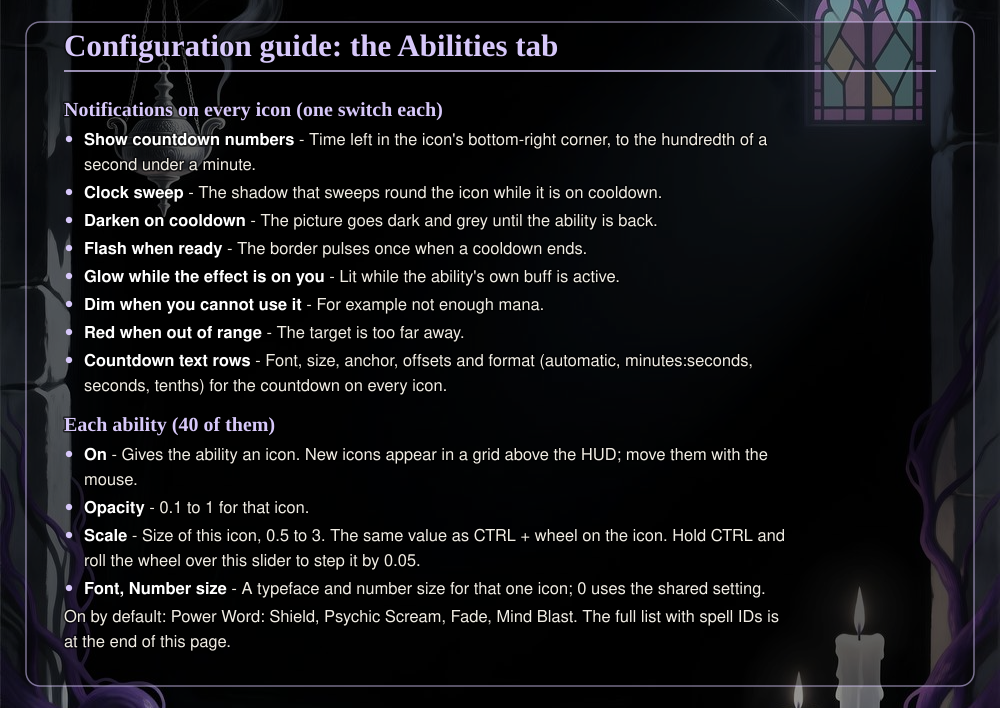

Text version: Configuration guide: the Abilities tab

**Notifications on every icon (one switch each)**

- **Show countdown numbers** - Time left in the icon's bottom-right corner, to the hundredth of a second under a minute.
- **Clock sweep** - The shadow that sweeps round the icon while it is on cooldown.
- **Darken on cooldown** - The picture goes dark and grey until the ability is back.
- **Flash when ready** - The border pulses once when a cooldown ends.
- **Glow while the effect is on you** - Lit while the ability's own buff is active.
- **Dim when you cannot use it** - For example not enough mana.
- **Red when out of range** - The target is too far away.
- **Countdown text rows** - Font, size, anchor, offsets and format (automatic, minutes:seconds, seconds, tenths) for the countdown on every icon.

**Each ability (40 of them)**

- **On** - Gives the ability an icon. New icons appear in a grid above the HUD; move them with the mouse.
- **Opacity** - 0.1 to 1 for that icon.
- **Scale** - Size of this icon, 0.5 to 3. The same value as CTRL + wheel on the icon. Hold CTRL and roll the wheel over this slider to step it by 0.05.
- **Font, Number size** - A typeface and number size for that one icon; 0 uses the shared setting.

On by default: Power Word: Shield, Psychic Scream, Fade, Mind Blast. The full list with spell IDs is at the end of this page.

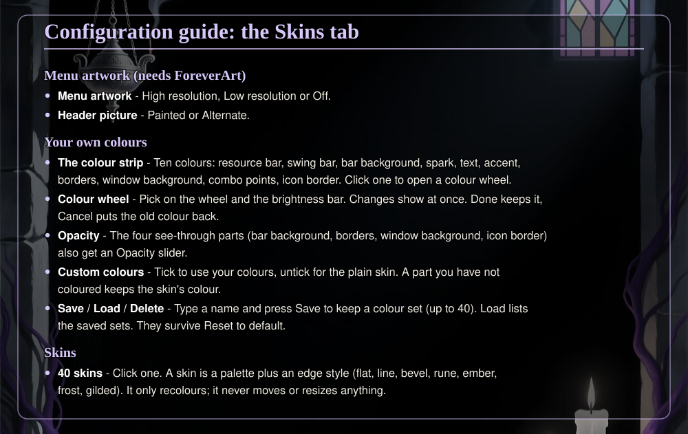

Text version: Configuration guide: the Skins tab

**Menu artwork (needs ForeverArt)**

- **Menu artwork** - High resolution, Low resolution or Off.
- **Header picture** - Painted or Alternate.

**Your own colours**

- **The colour strip** - Ten colours: resource bar, swing bar, bar background, spark, text, accent, borders, window background, combo points, icon border. Click one to open a colour wheel.
- **Colour wheel** - Pick on the wheel and the brightness bar. Changes show at once. Done keeps it, Cancel puts the old colour back.
- **Opacity** - The four see-through parts (bar background, borders, window background, icon border) also get an Opacity slider.
- **Custom colours** - Tick to use your colours, untick for the plain skin. A part you have not coloured keeps the skin's colour.
- **Save / Load / Delete** - Type a name and press Save to keep a colour set (up to 40). Load lists the saved sets. They survive Reset to default.

**Skins**

- **40 skins** - Click one. A skin is a palette plus an edge style (flat, line, bevel, rune, ember, frost, gilded). It only recolours; it never moves or resizes anything.

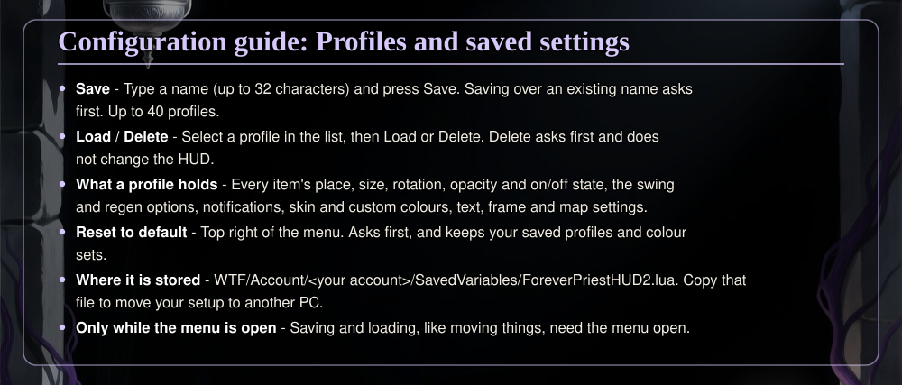

Text version: Configuration guide: Profiles and saved settings

- **Save** - Type a name (up to 32 characters) and press Save. Saving over an existing name asks first. Up to 40 profiles.
- **Load / Delete** - Select a profile in the list, then Load or Delete. Delete asks first and does not change the HUD.
- **What a profile holds** - Every item's place, size, rotation, opacity and on/off state, the swing and regen options, notifications, skin and custom colours, text, frame and map settings.
- **Reset to default** - Top right of the menu. Asks first, and keeps your saved profiles and colour sets.
- **Where it is stored** - WTF/Account/<your account>/SavedVariables/ForeverPriestHUD2.lua. Copy that file to move your setup to another PC.
- **Only while the menu is open** - Saving and loading, like moving things, need the menu open.

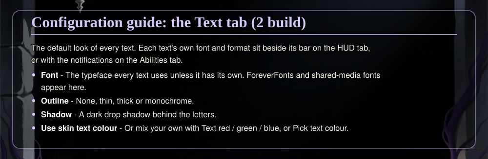

Text version: Configuration guide: the Text tab (2 build)

The default look of every text. Each text's own font and format sit beside its bar on the HUD tab, or with the notifications on the Abilities tab.

- **Font** - The typeface every text uses unless it has its own. ForeverFonts and shared-media fonts appear here.
- **Outline** - None, thin, thick or monochrome.
- **Shadow** - A dark drop shadow behind the letters.
- **Use skin text colour** - Or mix your own with Text red / green / blue, or Pick text colour.

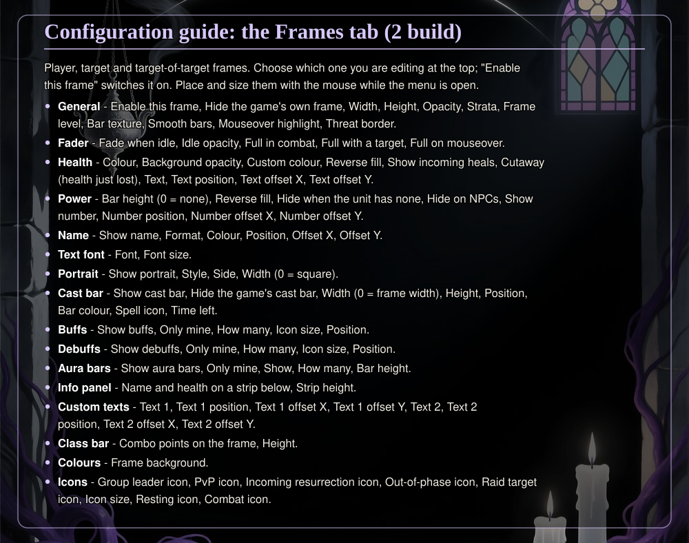

Text version: Configuration guide: the Frames tab (2 build)

Player, target and target-of-target frames. Choose which one you are editing at the top; "Enable this frame" switches it on. Place and size them with the mouse while the menu is open.

- **General** - Enable this frame, Hide the game's own frame, Width, Height, Opacity, Strata, Frame level, Bar texture, Smooth bars, Mouseover highlight, Threat border.
- **Fader** - Fade when idle, Idle opacity, Full in combat, Full with a target, Full on mouseover.
- **Health** - Colour, Background opacity, Custom colour, Reverse fill, Show incoming heals, Cutaway (health just lost), Text, Text position, Text offset X, Text offset Y.
- **Power** - Bar height (0 = none), Reverse fill, Hide when the unit has none, Hide on NPCs, Show number, Number position, Number offset X, Number offset Y.
- **Name** - Show name, Format, Colour, Position, Offset X, Offset Y.
- **Text font** - Font, Font size.
- **Portrait** - Show portrait, Style, Side, Width (0 = square).
- **Cast bar** - Show cast bar, Hide the game's cast bar, Width (0 = frame width), Height, Position, Bar colour, Spell icon, Time left.
- **Buffs** - Show buffs, Only mine, How many, Icon size, Position.
- **Debuffs** - Show debuffs, Only mine, How many, Icon size, Position.
- **Aura bars** - Show aura bars, Only mine, Show, How many, Bar height.
- **Info panel** - Name and health on a strip below, Strip height.
- **Custom texts** - Text 1, Text 1 position, Text 1 offset X, Text 1 offset Y, Text 2, Text 2 position, Text 2 offset X, Text 2 offset Y.
- **Class bar** - Combo points on the frame, Height.
- **Colours** - Frame background.
- **Icons** - Group leader icon, PvP icon, Incoming resurrection icon, Out-of-phase icon, Raid target icon, Icon size, Resting icon, Combat icon.

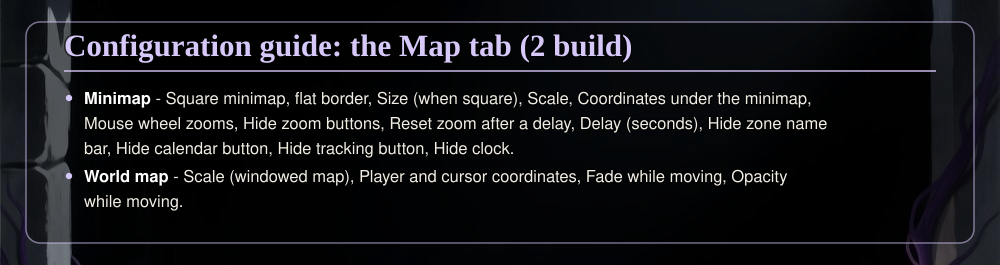

Text version: Configuration guide: the Map tab (2 build)

- **Minimap** - Square minimap, flat border, Size (when square), Scale, Coordinates under the minimap, Mouse wheel zooms, Hide zoom buttons, Reset zoom after a delay, Delay (seconds), Hide zone name bar, Hide calendar button, Hide tracking button, Hide clock.
- **World map** - Scale (windowed map), Player and cursor coordinates, Fade while moving, Opacity while moving.

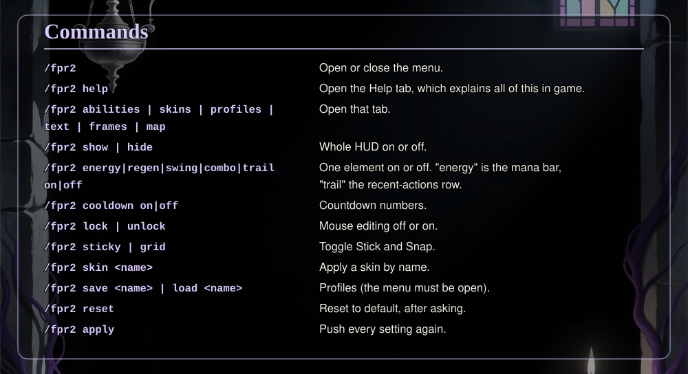

Text version: Commands

| Command | What it does |
|---|---|
| `/fpr2` | Open or close the menu. |
| `/fpr2 help` | Open the Help tab, which explains all of this in game. |
| `/fpr2 abilities \| skins \| profiles \| text \| frames \| map` | Open that tab. |
| `/fpr2 show \| hide` | Whole HUD on or off. |
| `/fpr2 energy\|regen\|swing\|combo\|trail on\|off` | One element on or off. "energy" is the mana bar, "trail" the recent-actions row. |
| `/fpr2 cooldown on\|off` | Countdown numbers. |
| `/fpr2 lock \| unlock` | Mouse editing off or on. |
| `/fpr2 sticky \| grid` | Toggle Stick and Snap. |
| `/fpr2 skin <name>` | Apply a skin by name. |
| `/fpr2 save <name> \| load <name>` | Profiles (the menu must be open). |
| `/fpr2 reset` | Reset to default, after asking. |
| `/fpr2 apply` | Push every setting again. |

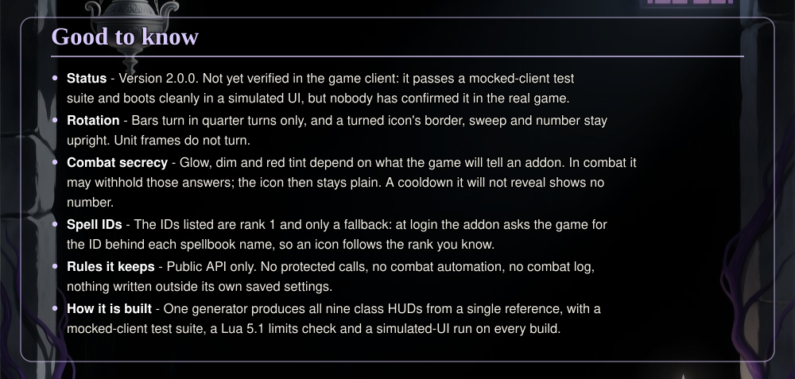

Text version: Good to know

- **Status** - Version 2.0.0. Not yet verified in the game client: it passes a mocked-client test suite and boots cleanly in a simulated UI, but nobody has confirmed it in the real game.
- **Rotation** - Bars turn in quarter turns only, and a turned icon's border, sweep and number stay upright. Unit frames do not turn.
- **Combat secrecy** - Glow, dim and red tint depend on what the game will tell an addon. In combat it may withhold those answers; the icon then stays plain. A cooldown it will not reveal shows no number.
- **Spell IDs** - The IDs listed are rank 1 and only a fallback: at login the addon asks the game for the ID behind each spellbook name, so an icon follows the rank you know.
- **Rules it keeps** - Public API only. No protected calls, no combat automation, no combat log, nothing written outside its own saved settings.
- **How it is built** - One generator produces all nine class HUDs from a single reference, with a mocked-client test suite, a Lua 5.1 limits check and a simulated-UI run on every build.

All 40 abilities and their fallback spell IDs

| Ability | Fallback ID | Default |
|---|---|---|
| Power Word: Shield | 17 | on |
| Psychic Scream | 8122 | on |
| Fade | 586 | on |
| Mind Blast | 8092 | on |
| Holy Fire | 14914 | off |
| Desperate Prayer | 13908 | off |
| Devouring Plague | 2944 | off |
| Fear Ward | 6346 | off |
| Elune's Grace | 2651 | off |
| Feedback | 13896 | off |
| Mana Burn | 8129 | off |
| Prayer of Healing | 596 | off |
| Renew | 139 | off |
| Flash Heal | 2061 | off |
| Dispel Magic | 527 | off |
| Shadow Word: Death | 401955 | off |
| Penance | 402174 | off |
| Prayer of Mending | 401859 | off |
| Inner Focus | 14751 | off |
| Power Infusion | 10060 | off |
| Silence | 15487 | off |
| Mind Flay | 15407 | off |
| Vampiric Embrace | 15286 | off |
| Holy Nova | 15237 | off |
| Lightwell | 724 | off |
| Smite | 585 | off |
| Shadow Word: Pain | 589 | off |
| Lesser Heal | 2050 | off |
| Heal | 2054 | off |
| Greater Heal | 2060 | off |
| Inner Fire | 588 | off |
| Power Word: Fortitude | 1243 | off |
| Shadowform | 15473 | off |
| Chastise | 1277331 | off |
| Confounding Flash | 1277455 | off |
| Binding Heal | 401937 | off |
| Divine Grace | 1277370 | off |
| Dark Sacrifice | 1277324 | off |
| Starshards | 10797 | off |
| Abolish Disease | 552 | off |

